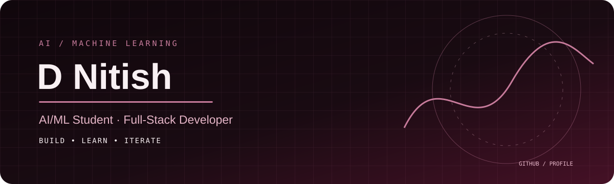

# D Nitish | AI/ML Engineer

  

  <b>AI/ML Student · Computer Vision · Full-Stack Development</b>

I'm a Computer Science and Engineering student specializing in AI & Machine Learning at KPR Institute of Engineering and Technology, Coimbatore. I enjoy building intelligent systems, practical AI applications, and full-stack software.

## 🚀 Featured Projects

- **Intelligent Poaching Detection System** — Wildlife surveillance using YOLOv8, Flask, and React.
- **Resume Intelligence System** — Resume parsing and structured candidate extraction using Python and FastAPI.
- **Business Entity Resolution** — Business record matching and data processing using Python, DuckDB, and Polars.

## 🛠️ Tech Stack

**Languages:** Python, SQL, JavaScript  
**AI/ML:** Machine Learning, Computer Vision, NumPy, Pandas  
**Backend:** FastAPI, Flask  
**Frontend:** React, HTML, CSS  
**Databases:** SQLite, PostgreSQL  
**Tools:** Git, GitHub, Google Colab

## 📫 Connect With Me

- GitHub: [@nitishkpriet](https://github.com/nitishkpriet)

---

*Building, learning, and improving one project at a time.*
