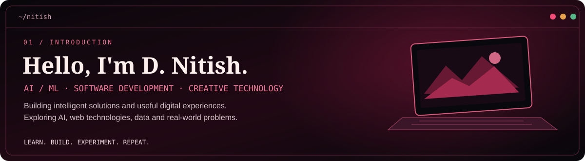

# D Nitish | AI/ML Engineer

  

  <strong>AI/ML Student · Computer Vision · Full-Stack Development</strong>

  Computer Science and Engineering student specializing in Artificial Intelligence and Machine Learning at KPR Institute of Engineering and Technology, Coimbatore.
   
  I enjoy building intelligent systems, practical AI applications, and full-stack software.

---

## `01 / FEATURED PROJECTS`

### Projects I've Built.

<table>
  <tr>
    <td width="50%" valign="top">
      <h3>🏥 Smart Hospital Patient Assistant</h3>
      Healthcare-focused digital assistant designed to support patients.
        
      <code>Healthcare</code> <code>AI</code>
        
      <a href="https://github.com/Dhanush-Kumar-007/Smart-Hospital-Patient-Assistant">↗ View Repository</a>
    </td>
    <td width="50%" valign="top">
      <h3>🎓 CertiTrack</h3>
      A certificate tracking and management project.
        
      <code>Web Development</code> <code>Certification</code>
        
      <a href="https://github.com/DharankumarB/certitrack">↗ View Repository</a>
    </td>
  </tr>
  <tr>
    <td width="50%" valign="top">
      <h3>🤖 HR Interview AI</h3>
      An AI-focused interview project.
        
      <code>AI</code> <code>Interview Tools</code>
        
      <a href="https://github.com/vozlookstudios-stack/HR-Intervw-AI">↗ View Repository</a>
    </td>
    <td width="50%" valign="top">
      <h3>💼 Job Website</h3>
      A web-based job portal with skill-based job and course recommendations.
        
      <code>HTML</code> <code>CSS</code> <code>JavaScript</code>
        
      <a href="https://github.com/nitishkpriet/job-website">↗ View Repository</a>
    </td>
  </tr>
</table>

  <i>Engineering intelligence. Building for impact.</i>

---

## `02 / TECH STACK`

### Tools & Technologies.

  <strong>LANGUAGES</strong>
    
  

  <strong>AI / ML & DATA</strong>
    
  
    
  <code>NumPy</code> <code>Pandas</code> <code>scikit-learn</code>

  <strong>WEB DEVELOPMENT</strong>
    
  

  <strong>DATABASES & TOOLS</strong>
    
  

  <i>Learning continuously. Building thoughtfully.</i>

---

## `03 / GITHUB ACTIVITY`

### My GitHub at a Glance.

  
  

  

### Contribution Snake

  

---

---

## `04 / CURRENT FOCUS`

### What I'm Working On.

<table>
  <tr>
    <td width="50%" valign="top">
      <h3>🧠 Artificial Intelligence</h3>
      Exploring machine learning, computer vision, and practical AI applications.
        
      <code>Python</code> <code>Machine Learning</code>
    </td>
    <td width="50%" valign="top">
      <h3>💻 Software Development</h3>
      Building web applications and improving my full-stack development skills.
        
      <code>HTML</code> <code>CSS</code> <code>JavaScript</code>
    </td>
  </tr>
  <tr>
    <td width="50%" valign="top">
      <h3>🛠️ Project Building</h3>
      Turning ideas into working projects and improving code quality.
        
      <code>Git</code> <code>GitHub</code>
    </td>
    <td width="50%" valign="top">
      <h3>📚 Continuous Learning</h3>
      Strengthening technical foundations through hands-on practice and experimentation.
        
      <code>Learn</code> <code>Build</code> <code>Improve</code>
    </td>
  </tr>
</table>

  <i>Curiosity drives the process. Consistency builds the results.</i>

---

## `05 / LET'S CONNECT`

### Have an idea? Let's build something.

  

  <code>LEARN</code> &nbsp; / &nbsp;
  <code>CREATE</code> &nbsp; / &nbsp;
  <code>INNOVATE</code>

  <i>Thanks for visiting my corner of GitHub.</i>
   
  Designed with curiosity. Built with code.

